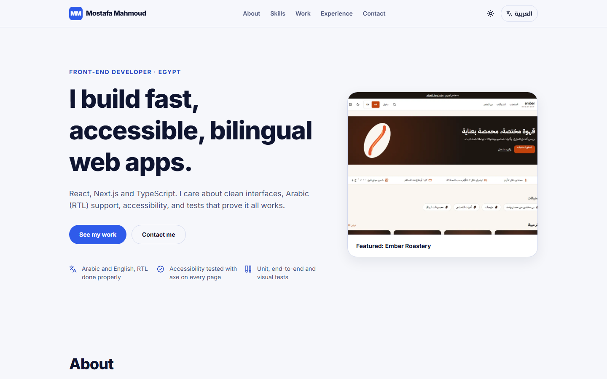
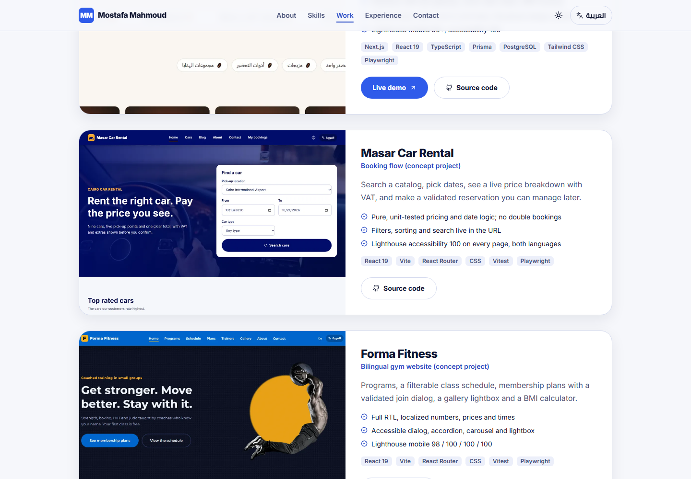
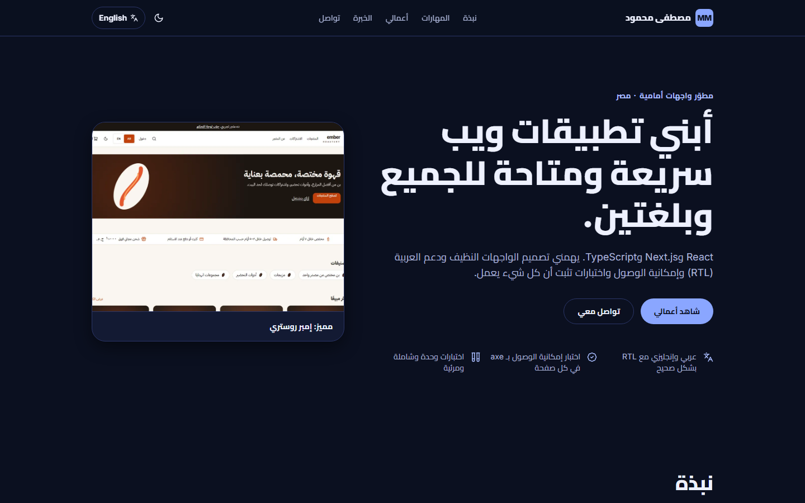
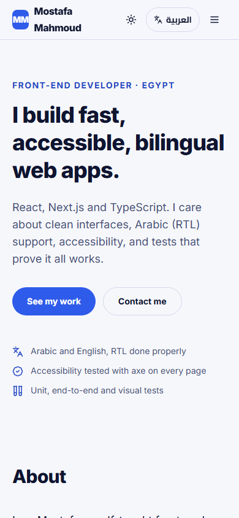

# Mostafa Mahmoud: Front-End Developer Portfolio

My portfolio: four tested projects, my experience and how to reach me. Bilingual (English and Arabic with full RTL), light and dark, and built to score 100 on Lighthouse accessibility.

> **Live site:** https://mostafa-portfolio-ruddy.vercel.app



| Selected work | Arabic, dark theme | Phone |
| --- | --- | --- |
|  |  |  |

## What is on the page

- **Hero**, **About**, **Skills** (grouped), **Selected work**, **Experience**, **Contact**.
- **Four projects**, each with a screenshot, what it proves, the numbers that back it up (tests, Lighthouse), its stack, and Source code and Live demo buttons. A Live demo button only appears once a project is deployed.
- **Arabic and English** with real RTL (logical CSS properties, mirrored layout), and **light and dark** themes. Both are remembered and applied before first paint, so there is no flash.
- Accessible by default: skip link, current-section highlighting in the nav, labelled controls, visible focus, reduced motion respected, and accessible names that contain the visible text.
- SEO: per-page title and description, Open Graph image, JSON-LD `Person`, `robots.txt`.

## Tech

React 19 · Vite · Tailwind CSS 4 · self-hosted fonts (Inter, Cairo) · Vitest · Playwright · axe-core · ESLint 9.

All content is data: personal details in `src/data/profile.js`, projects in `src/data/projects.js` (every string is `{ en, ar }`), interface text in `src/i18n`.

## Edit it

- **Contact details and links:** `src/data/profile.js`.
- **CV:** edit `cv/cv.html`, then run `npm run cv` to rebuild `public/Mostafa-Mahmoud-CV.pdf` (one A4 page, plain text so applicant-tracking systems can read it). The hero button comes from `cvUrl` in `profile.js`.
- **Add a live link to a project:** set `live` in `src/data/projects.js`.
- **Add a project:** add an entry there and a screenshot in `src/assets/projects/` (a test checks the image exists).

## Run it

```bash
npm install
npm run dev        # http://localhost:3000
npm run build
npm run preview
```

## Tests

```bash
npm run lint
npm test                 # unit tests
npx playwright install   # once
npm run test:e2e         # end-to-end and accessibility on Chromium, Firefox, WebKit and a phone viewport
npm run test:visual      # screenshot regression (Chromium; baselines are per platform)
```

- **Unit (8):** English and Arabic have identical keys and placeholders, every key used in the code exists and none is unused, every project string exists in both languages, links and contact details are well formed, every screenshot exists.
- **End-to-end and accessibility (100 runs):** content and metadata, project order, links (source, live, mailto, tel, LinkedIn, GitHub) with safe `rel`, in-page navigation with current-section marking, mobile menu and Escape, skip link, language and theme persistence, corrupted storage, no horizontal scroll, and **axe-core in English and Arabic, light and dark**, plus the open mobile menu and a keyboard focus check.
- Skipped on WebKit with a stated reason: Safari does not Tab to links by default.

## Quality numbers

Lighthouse on the production build:

| | Performance | Accessibility | Best practices | SEO |
| --- | --- | --- | --- | --- |
| Desktop | 100 | 100 | 100 | 100 |
| Mobile (simulated slow 4G) | 98 | 100 | 100 | 100 |

## History

The first version was a Create React App page with placeholder copy (`Lorem ipsum`), skills that listed the wrong language, a broken email link, and project links on a host that was unreachable from Egypt without a VPN. The original is in the git history.
